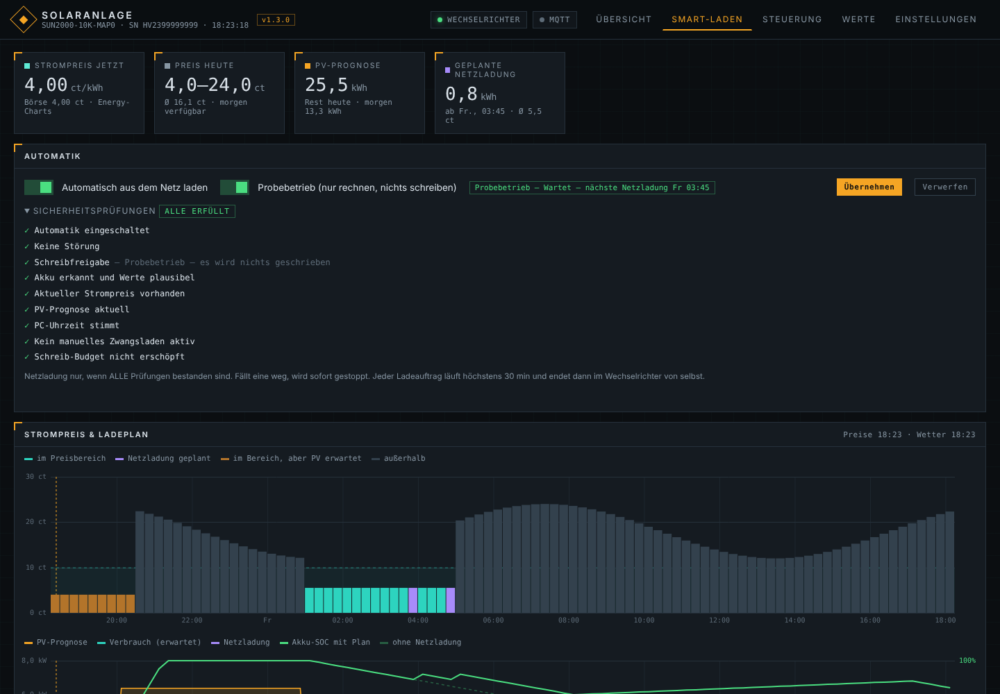
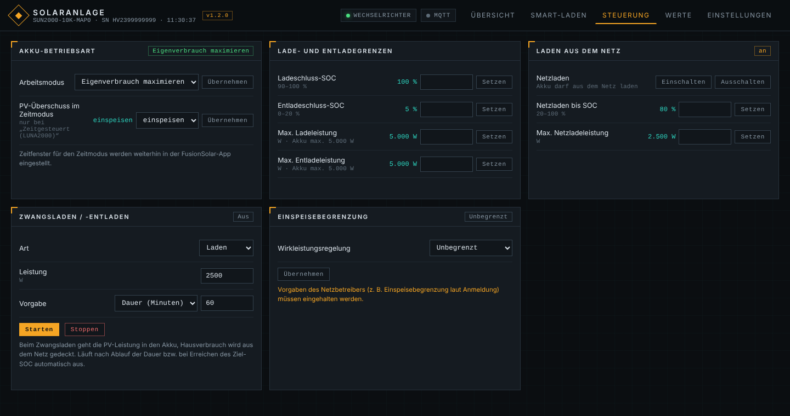

# Huawei-Solar-Dashboard-MK1

Zeigt die Live-Daten eines **Huawei SUN2000-5/6/8/10/12K-MAP0** Hybrid-Wechselrichters mit **LUNA2000-Akku** und **Smart Meter** auf einer Webseite im lokalen Netzwerk an und sendet jeden Wert als **eigenes MQTT-Topic** an einen Broker.


<p align="center"></p>





<sub>Screenshots mit Testdaten aus dem mitgelieferten Simulator.</sub>

- PV-Leistung gesamt und je String (Spannung, Strom, Leistung)
- Akku: Ladezustand (SOC), Lade-/Entladeleistung, Status, Temperatur, Tages- und Gesamtenergie
- Netz (Smart Meter): Bezug/Einspeisung, Phasenwerte, Zählerstände
- Wechselrichter: Ausgangsleistung, Status, Temperatur, Wirkungsgrad, Frequenz, Phasenspannungen und -ströme, Tages- und Gesamtertrag
- Berechnet: Hausverbrauch, Autarkiegrad, Eigenverbrauchsquote
- Energiefluss-Grafik, Verlauf bis 48 h (bleibt über Neustarts erhalten)
- Einstellungen komplett auf der Webseite, gespeichert in `config.json` neben der exe
- Nur Python-Standardbibliothek – keine Zusatzpakete, auch unter Linux / Raspberry Pi lauffähig
- **Sicherheit zuerst**: ab Werk nur lesend; Schreiben nur mit PIN, bestätigter Anlage und bestandenen Prüfungen; Smart-Laden startet im Probebetrieb; automatische Sicherheitstests vor jedem Build
- **Smart-Laden**: aktueller EPEX-Strompreis aus dem Internet, Akku automatisch unterhalb einer Preisgrenze aus dem Netz laden – unter Berücksichtigung der erwarteten Sonneneinstrahlung, alle Parameter per Schieberegler
- **Steuerung** (optional, standardmäßig gesperrt): Arbeitsmodus, Lade-/Entladegrenzen, Laden aus dem Netz, Zwangsladen/-entladen, Einspeisebegrenzung
- Stabile Verbindung: hält die eine Modbus-Verbindung offen, verbindet nur schonend neu, Verbindungsstatistik und Protokolldatei

## Start (Windows)

1. Zip aus dem Release entpacken.
2. `Huawei-Solar-Dashboard-MK1.exe` starten (Konsolenfenster zeigt das Protokoll).
3. Im Browser `http://<IP-des-Rechners>:8095/` öffnen → **Einstellungen**.
4. Wechselrichter-IP eintragen → **Verbindung testen** (probiert automatisch die Unit-IDs 1, 0 und 100) → **Speichern**.
5. Optional MQTT-Broker eintragen, „MQTT aktiv“ anhaken, speichern.

Beim ersten Start fragt Windows evtl. nach der Firewall-Freigabe – zulassen, damit die Seite im Netzwerk erreichbar ist.

## Modbus TCP am Wechselrichter freischalten

In der **FusionSolar-App** (lokal am Wechselrichter angemeldet, Installateur-Konto):
`Einstellungen → Kommunikationskonfiguration → Dongle-Parameter (bzw. Modbus TCP)` → **Aktivieren (uneingeschränkt)**.

| Anbindung | IP | Port | Unit-ID |
|---|---|---|---|
| SDongleA-05 im Heimnetz | IP des Dongles | 502 | meist 1 |
| integriertes WLAN-FE im Heimnetz (neuere Firmware) | IP des Wechselrichters | 502 | 0 oder 1 |
| Direkt am WLAN-Hotspot des Wechselrichters | 192.168.200.1 | 6607 | 0 |

Hinweise:
- Huawei bedient **nur einen Modbus-TCP-Client zuverlässig gleichzeitig**. Läuft schon eine andere Abfrage (z. B. Home Assistant, evcc), gibt es Abbrüche.
- Nach dem Verbindungsaufbau braucht das Gerät ca. 1–2 s Pause („Pause nach Verbinden“).
- Abfrageintervall nicht unter 5 s stellen – der SDongle ist langsam. Timeout 15 s.

## MQTT

Alle Topics liegen unter dem Basis-Topic (Standard `huawei_solar`), z. B. `huawei_solar/akku/soc_pct`.
Werte werden als reine Zahl bzw. Text gesendet (Punkt als Dezimaltrenner).

- `…/status` – `online` / `offline` (Last Will, retained)
- `…/json` – alle Werte zusammen als JSON (abschaltbar)
- `…/akku/vorhanden`, `…/netz/zaehler_vorhanden` – `1` / `0`
- Akku-Topics werden nur gesendet, wenn ein Akku erkannt wurde; Netz-/Haus-Topics nur mit Smart Meter.
- Vorzeichen: `akku/leistung_w` **+ = laden**, `netz/leistung_w` **+ = Einspeisung**. Zusätzlich gibt es getrennte, immer positive Topics (`akku/ladeleistung_w`, `akku/entladeleistung_w`, `netz/bezug_w`, `netz/einspeisung_w`).
- Option „Nur Änderungen senden“: unveränderte Werte werden erst nach „Senden erzwingen nach (s)“ erneut gesendet.

| Gruppe | Topic (nach Basis-Topic) | Bedeutung | Einheit | Register |
|---|---|---|---|---|
| Gerät | `geraet/modell` | Modell | – | 30000 |
| Gerät | `geraet/seriennummer` | Seriennummer | – | 30015 |
| Gerät | `geraet/pv_strings` | Anzahl PV-Strings | – | 30071 |
| Gerät | `geraet/mpp_tracker` | Anzahl MPP-Tracker | – | 30072 |
| Gerät | `geraet/nennleistung_w` | Nennleistung | W | 30073 |
| PV | `pv/string1/spannung_v` | String 1 Spannung | V | 32016 |
| PV | `pv/string1/strom_a` | String 1 Strom | A | 32017 |
| PV | `pv/string2/spannung_v` | String 2 Spannung | V | 32018 |
| PV | `pv/string2/strom_a` | String 2 Strom | A | 32019 |
| PV | `pv/string3/spannung_v` | String 3 Spannung | V | 32020 |
| PV | `pv/string3/strom_a` | String 3 Strom | A | 32021 |
| PV | `pv/string4/spannung_v` | String 4 Spannung | V | 32022 |
| PV | `pv/string4/strom_a` | String 4 Strom | A | 32023 |
| PV | `pv/leistung_w` | PV-Eingangsleistung | W | 32064 |
| PV | `pv/string1/leistung_w` | String 1 Leistung | W | berechnet |
| PV | `pv/string2/leistung_w` | String 2 Leistung | W | berechnet |
| PV | `pv/string3/leistung_w` | String 3 Leistung | W | berechnet |
| PV | `pv/string4/leistung_w` | String 4 Leistung | W | berechnet |
| Wechselrichter | `wechselrichter/alarm1` | Alarm 1 (Bitfeld) | – | 32008 |
| Wechselrichter | `wechselrichter/alarm2` | Alarm 2 (Bitfeld) | – | 32009 |
| Wechselrichter | `wechselrichter/alarm3` | Alarm 3 (Bitfeld) | – | 32010 |
| Wechselrichter | `wechselrichter/spannung_l1_l2_v` | Spannung L1-L2 | V | 32066 |
| Wechselrichter | `wechselrichter/spannung_l2_l3_v` | Spannung L2-L3 | V | 32067 |
| Wechselrichter | `wechselrichter/spannung_l3_l1_v` | Spannung L3-L1 | V | 32068 |
| Wechselrichter | `wechselrichter/spannung_l1_v` | Spannung L1 | V | 32069 |
| Wechselrichter | `wechselrichter/spannung_l2_v` | Spannung L2 | V | 32070 |
| Wechselrichter | `wechselrichter/spannung_l3_v` | Spannung L3 | V | 32071 |
| Wechselrichter | `wechselrichter/strom_l1_a` | Strom L1 | A | 32072 |
| Wechselrichter | `wechselrichter/strom_l2_a` | Strom L2 | A | 32074 |
| Wechselrichter | `wechselrichter/strom_l3_a` | Strom L3 | A | 32076 |
| Wechselrichter | `wechselrichter/spitzenleistung_heute_w` | Spitzenleistung heute | W | 32078 |
| Wechselrichter | `wechselrichter/leistung_w` | Ausgangsleistung (Wirkleistung) | W | 32080 |
| Wechselrichter | `wechselrichter/blindleistung_var` | Blindleistung | var | 32082 |
| Wechselrichter | `wechselrichter/leistungsfaktor` | Leistungsfaktor | – | 32084 |
| Wechselrichter | `wechselrichter/frequenz_hz` | Netzfrequenz | Hz | 32085 |
| Wechselrichter | `wechselrichter/wirkungsgrad_pct` | Wirkungsgrad | % | 32086 |
| Wechselrichter | `wechselrichter/temperatur_c` | Innentemperatur | °C | 32087 |
| Wechselrichter | `wechselrichter/isolation_mohm` | Isolationswiderstand | MΩ | 32088 |
| Wechselrichter | `wechselrichter/status_code` | Gerätestatus (Code) | – | 32089 |
| Wechselrichter | `wechselrichter/ertrag_gesamt_kwh` | Gesamtertrag | kWh | 32106 |
| Wechselrichter | `wechselrichter/ertrag_heute_kwh` | Tagesertrag | kWh | 32114 |
| Wechselrichter | `wechselrichter/status` | Gerätestatus | – | berechnet |
| Akku | `akku/temperatur_c` | Akkutemperatur (Einheit 1) | °C | 37022 |
| Akku | `akku/max_ladeleistung_w` | Max. Ladeleistung | W | 37046 |
| Akku | `akku/max_entladeleistung_w` | Max. Entladeleistung | W | 37048 |
| Akku | `akku/kapazitaet_wh` | Nennkapazität | Wh | 37758 |
| Akku | `akku/soc_pct` | Ladezustand (SOC) | % | 37760 |
| Akku | `akku/status_code` | Betriebsstatus (Code) | – | 37762 |
| Akku | `akku/bus_spannung_v` | Bus-Spannung | V | 37763 |
| Akku | `akku/bus_strom_a` | Bus-Strom | A | 37764 |
| Akku | `akku/leistung_w` | Lade-/Entladeleistung (+ laden) | W | 37765 |
| Akku | `akku/geladen_gesamt_kwh` | Gesamt geladen | kWh | 37780 |
| Akku | `akku/entladen_gesamt_kwh` | Gesamt entladen | kWh | 37782 |
| Akku | `akku/geladen_heute_kwh` | Heute geladen | kWh | 37784 |
| Akku | `akku/entladen_heute_kwh` | Heute entladen | kWh | 37786 |
| Akku | `akku/status` | Betriebsstatus | – | berechnet |
| Akku | `akku/ladeleistung_w` | Ladeleistung | W | berechnet |
| Akku | `akku/entladeleistung_w` | Entladeleistung | W | berechnet |
| Netz | `netz/zaehler_status` | Zählerstatus (1 = normal) | – | 37100 |
| Netz | `netz/spannung_l1_v` | Spannung L1 | V | 37101 |
| Netz | `netz/spannung_l2_v` | Spannung L2 | V | 37103 |
| Netz | `netz/spannung_l3_v` | Spannung L3 | V | 37105 |
| Netz | `netz/strom_l1_a` | Strom L1 | A | 37107 |
| Netz | `netz/strom_l2_a` | Strom L2 | A | 37109 |
| Netz | `netz/strom_l3_a` | Strom L3 | A | 37111 |
| Netz | `netz/leistung_w` | Netzleistung (+ Einspeisung) | W | 37113 |
| Netz | `netz/blindleistung_var` | Blindleistung | var | 37115 |
| Netz | `netz/leistungsfaktor` | Leistungsfaktor | – | 37117 |
| Netz | `netz/frequenz_hz` | Frequenz | Hz | 37118 |
| Netz | `netz/eingespeist_gesamt_kwh` | Eingespeist gesamt | kWh | 37119 |
| Netz | `netz/bezogen_gesamt_kwh` | Bezogen gesamt | kWh | 37121 |
| Netz | `netz/leistung_l1_w` | Leistung L1 | W | 37132 |
| Netz | `netz/leistung_l2_w` | Leistung L2 | W | 37134 |
| Netz | `netz/leistung_l3_w` | Leistung L3 | W | 37136 |
| Netz | `netz/bezug_w` | Bezug aus dem Netz | W | berechnet |
| Netz | `netz/einspeisung_w` | Einspeisung ins Netz | W | berechnet |
| Haus | `haus/verbrauch_w` | Hausverbrauch | W | berechnet |
| Haus | `haus/eigenverbrauch_pct` | Eigenverbrauchsquote (aktuell) | % | berechnet |
| Haus | `haus/autarkie_pct` | Autarkiegrad (aktuell) | % | berechnet |
| Steuerung | `steuerung/max_ladeleistung_w` | Max. Ladeleistung | W | 47075 |
| Steuerung | `steuerung/max_entladeleistung_w` | Max. Entladeleistung | W | 47077 |
| Steuerung | `steuerung/ladeschluss_soc_pct` | Ladeschluss-SOC | % | 47081 |
| Steuerung | `steuerung/entladeschluss_soc_pct` | Entladeschluss-SOC | % | 47082 |
| Steuerung | `steuerung/zwang_dauer_min` | Zwangsladen/-entladen: Dauer | min | 47083 |
| Steuerung | `steuerung/arbeitsmodus_code` | Arbeitsmodus (Code) | – | 47086 |
| Steuerung | `steuerung/netzladen` | Laden aus dem Netz (1 = an) | – | 47087 |
| Steuerung | `steuerung/netzladen_soc_pct` | Netzladen bis SOC | % | 47088 |
| Steuerung | `steuerung/zwang_code` | Zwangsladen/-entladen (0 Stopp, 1 Laden, 2 Entladen) | – | 47100 |
| Steuerung | `steuerung/zwang_ziel_soc_pct` | Zwangsladen/-entladen: Ziel-SOC | % | 47101 |
| Steuerung | `steuerung/netzladen_leistung_w` | Max. Netzladeleistung | W | 47244 |
| Steuerung | `steuerung/zwang_vorgabe_code` | Zwang-Vorgabe (0 Dauer, 1 Ziel-SOC) | – | 47246 |
| Steuerung | `steuerung/zwang_ladeleistung_w` | Zwangsladeleistung | W | 47247 |
| Steuerung | `steuerung/zwang_entladeleistung_w` | Zwangsentladeleistung | W | 47249 |
| Steuerung | `steuerung/pv_ueberschuss_zeitmodus` | PV-Überschuss im Zeitmodus (0 einspeisen, 1 laden) | – | 47299 |
| Steuerung | `steuerung/einspeise_modus_code` | Wirkleistungsregelung (Code) | – | 47415 |
| Steuerung | `steuerung/einspeise_max_w` | Max. Einspeiseleistung | W | 47416 |
| Steuerung | `steuerung/einspeise_max_pct` | Max. Einspeiseleistung (%) | % | 47418 |
| Steuerung | `steuerung/arbeitsmodus` | Arbeitsmodus | – | berechnet |
| Steuerung | `steuerung/zwang` | Zwangsladen/-entladen | – | berechnet |
| Steuerung | `steuerung/einspeise_modus` | Wirkleistungsregelung | – | berechnet |

## Sicherheit

**Ehrlicher Hinweis vorweg:** Keine Software kann eine Fehlsteuerung mit absoluter Sicherheit ausschließen. Dieses Programm ist deshalb so gebaut, dass es **im Zweifel nichts tut** – und dass mehrere voneinander unabhängige Sperren greifen, bevor überhaupt ein Wert in den Wechselrichter geschrieben wird. Die eigenen Schutzfunktionen von Wechselrichter und Akku (Lade-/Entladegrenzen, BMS) bleiben davon unberührt und sind die letzte Sicherung.

**Ab Werk nur lesend.** Das Programm schreibt nichts, solange die Steuerung nicht ausdrücklich freigegeben ist.

**Freigabe (Einstellungen → Steuerung)** nur mit
- **PIN** (mind. 4 Zeichen, Pflicht) und
- **Bestätigung der Anlage**: Modell und Seriennummer der verbundenen Anlage werden gespeichert. Unterstützt werden SUN2000-…-MAP0 und SUN2000-…KTL-M1.
- Freigeben, Einspeisebegrenzung freigeben und PIN ändern verlangen die **aktuelle PIN**. Sperren geht immer ohne PIN.

**Bei jedem einzelnen Schreibbefehl**
1. nur Register aus der festen Liste der Steuerregister (alles andere wird verweigert)
2. Wertebereich geprüft, bevor etwas gesendet wird
3. **Seriennummer wird direkt vor dem Schreiben aus dem Gerät gelesen** – passt sie nicht zur bestätigten Anlage, wird nichts geschrieben (schützt z. B. bei IP-Wechsel im Netzwerk)
4. Messwerte müssen aktuell sein (sonst keine Steuerung)
5. jeder Wert wird **zurückgelesen**; Abweichung = Fehler (Automatik: Störung, gesperrt bis zum Quittieren)
6. Befehle, deren Aufrufer wegen Zeitüberschreitung aufgegeben hat, werden **verworfen**, nie verspätet ausgeführt
7. Einspeisebegrenzung nur, wenn sie zusätzlich freigegeben ist
8. Entladeschluss-SOC nie unter 5 % (Reserve gegen Tiefentladung durch Selbstentladung bei längerem Stillstand; steht am Wechselrichter bereits ein kleinerer Wert, weist die Seite darauf hin)

**Smart-Laden**
- startet im **Probebetrieb**: rechnet, zeigt und protokolliert („würde jetzt laden …“), schreibt aber nie. Erst nach Abschalten des Probebetriebs (mit PIN) wird geladen – sinnvoll erst nach einigen Tagen Beobachtung.
- lädt nur, wenn **alle Sicherheitsprüfungen** bestanden sind (sichtbar im Reiter): Schreibfreigabe, Akku-Werte plausibel, aktueller Strompreis (≤ 3 h alt, plausibel), aktuelle PV-Prognose (≤ 6 h) bzw. ≥ 3 Tage Statistik, **PC-Uhrzeit stimmt** (Abgleich mit der Serverzeit, max. 5 min Abweichung), kein manuelles Zwangsladen, Schreib-Budget nicht erschöpft, keine Störung. Fällt eine Prüfung weg, wird sofort gestoppt.
- jeder Ladeauftrag läuft **höchstens 30 Minuten** und endet dann im Wechselrichter von selbst – auch wenn das Programm abstürzt, der PC ausgeht oder das Netzwerk weg ist.
- „Laden aus dem Netz“ wird nur für die Dauer der Netzladung eingeschaltet und danach **auf den vorherigen Wert zurückgesetzt** (auch nach einem Absturz beim nächsten Start).
- beim Beenden (auch Schließen des Fensters, Abmelden, Herunterfahren) wird eine laufende Netzladung beendet.
- **Schreib-Budget**: max. 12 Befehle pro Stunde / 80 pro Tag, sonst Störung.
- Plausibilitätsprüfung der Internetdaten (Preise −1000…5000 €/MWh, lückenloses Zeitraster, Strahlung 0…1500 W/m²); unplausible Daten werden verworfen.
- Planer-Regeln, die nie verletzt werden dürfen (in den Tests mit 2000 Zufallsszenarien geprüft): nur unter der Preisgrenze, nie über den Ziel-SOC, nie mehr als die eingestellte Leistung, Netzladung verdrängt nie PV-Energie, ohne Preise keine Ladung.

**Webseite**
- Anfragen anderer Webseiten (Cross-Site) werden abgewiesen; alle Änderungen werden mit IP-Adresse protokolliert (`daten/protokoll.log`).

**Automatische Tests** (`tests/`, laufen bei jedem Push unter Windows und Linux; ohne bestandene Tests wird keine exe gebaut):
- `test_sicherheit.py`: Planer-Regeln (2000 Zufallsszenarien), jede Sicherheitsprüfung sperrt einzeln, Wertebereiche, Schreib-Whitelist, falsche Seriennummer schreibt nichts, Rücklese-Prüfung, Plausibilität der Internetdaten.
- `test_integration.py`: echtes Programm + Wechselrichter-Simulator: fremde Herkunft abgewiesen, Freigabe nur mit PIN und Bestätigung, **Probebetrieb schreibt nie**, Scharfschalten nur mit PIN, max. 30 min je Auftrag, Stopp und Zurücksetzen, **fremdes Gerät wird nie beschrieben**, Rücklesefehler → Störung.

Lokal ausführen: `python -m unittest discover -s tests -v`

**Empfehlung für den Start an der echten Anlage**
1. Zuerst nur lesend betreiben und Werte mit der FusionSolar-App vergleichen.
2. Einzelne Steuerbefehle von Hand testen (z. B. Entladeschluss-SOC) und in der App kontrollieren.
3. Smart-Laden einige Tage im Probebetrieb laufen lassen und die Entscheidungen im Protokoll prüfen.
4. Erst dann scharf schalten.

## Smart-Laden (EPEX-Strompreis + PV-Prognose)

Reiter **Smart-Laden**. Das Programm holt den Day-Ahead-Börsenpreis (EPEX, 15-Minuten-Raster) und eine PV-Prognose aus dem Internet und lädt den Akku automatisch aus dem Netz, wenn der Preis höchstens die eingestellte **Preisgrenze** erreicht (negative Börsenpreise sind immer eingeschlossen) – aber nur so viel, dass der erwartete PV-Überschuss danach noch in den Akku passt.

**Beispiel:** Strom ist um 7 Uhr günstig, ab 8 Uhr wird viel Sonne erwartet. Dann lädt die Automatik um 7 Uhr nicht (oder nur so weit, wie die Sonne den Akku später nicht ohnehin füllen würde). An einem trüben Tag lädt sie dagegen im günstigen Zeitfenster bis zum Ziel-SOC.

**So plant das Programm**
1. Viertelstundenweise über die Vorausschau (Standard 24 h): Preis, erwartete PV-Leistung, erwarteter Verbrauch.
2. Simulation des Akkustands ohne Netzladung.
3. Die günstigsten Viertelstunden unter der Preisgrenze bekommen nacheinander Netzladung – jeweils höchstens so viel, dass später kein zusätzlicher PV-Überschuss verloren geht (Akku voll → Einspeisung) und höchstens bis zum Ziel-SOC.
4. Ausführung über *Zwangsladen* (Dauer-Modus, höchstens 30 min am Stück, wird bei Bedarf verlängert). Läuft das Programm nicht mehr, endet das Laden spätestens nach Ablauf der Dauer von selbst. „Laden aus dem Netz“ wird nur währenddessen eingeschaltet und danach zurückgesetzt.

Die Diagramme zeigen Preise (grün = im Bereich, violett = Netzladung geplant, orange = im Bereich, aber PV erwartet), PV-Prognose, erwarteten Verbrauch und den Akkustand mit und ohne Plan. Beim Verschieben eines Reglers wird der Plan sofort als Vorschau neu gerechnet; erst **Übernehmen** speichert (mit PIN, falls gesetzt).

| Schieberegler | Bedeutung |
|---|---|
| Preisgrenze | Netzladung nur, wenn der Preis höchstens so hoch ist (0–60 ct/kWh). Negative Börsenpreise – in Deutschland 2025 über 570 Stunden – sind immer eingeschlossen, denn sie sind die günstigsten Zeiten |
| Ziel-SOC | bis zu diesem Ladezustand aus dem Netz laden (Nachladen erst ab 3 % darunter) |
| Ladeleistung aus dem Netz | Leistung beim Zwangsladen |
| Vorausschau | Planungszeitraum in Stunden |
| PV-Prognose berücksichtigen | 0 % = Sonne ignorieren, 100 % = Prognose voll vertrauen (vorsichtig: z. B. 70–80 %) |
| Anlagenleistung, Modulneigung, Ausrichtung, Systemwirkungsgrad | für die Umrechnung Einstrahlung → PV-Leistung |
| Aufschlag, MwSt | Endpreis = (Börsenpreis + Aufschlag) × (1 + MwSt) – darauf beziehen sich die Preisgrenzen |
| Grundlast | Verbrauch, solange noch keine eigene Statistik vorliegt |

**PV-Prognose:** Standard ist die Wetterprognose von Open-Meteo (Einstrahlung auf die geneigte Modulfläche) für den eingestellten Standort (Ortssuche). Ohne Standort oder Internet wird die **eigene Statistik** genutzt: mittlere PV-Leistung je Stunde der letzten 14 Tage. Mit „Prognose an die eigene Anlage anpassen“ vergleicht das Programm Prognose und gemessene Leistung (ab 12 auswertbaren Stunden) und korrigiert die Prognose (Faktor 0,5–1,3).

**Verbrauch:** aus den eigenen Messwerten (Hausverbrauch je Stunde, letzte 14 Tage, Datei `daten/statistik.json`). Braucht den Smart Meter.

**Voraussetzungen:** Akku, Internet. Für den scharfen Betrieb zusätzlich die freigegebene Steuerung (PIN, bestätigte Anlage). Im Probebetrieb geht alles ohne Freigabe. Läuft gerade ein manuelles Zwangsladen, wartet die Automatik.

**Quellen:** Strompreis von Energy-Charts (Fraunhofer ISE, DE-LU unter CC BY 4.0), bei Ausfall für DE-LU/AT von aWATTar. Wetter und Ortssuche von Open-Meteo (frei für nicht-kommerzielle Nutzung). Preise für morgen gibt es ab ca. 13 Uhr.

Zusätzliche MQTT-Topics: `strompreis/aktuell_ct`, `strompreis/boerse_ct`, `strompreis/heute_min_ct`, `strompreis/heute_max_ct`, `strompreis/heute_mittel_ct`, `prognose/pv_rest_heute_kwh`, `prognose/pv_morgen_kwh`, `smartladen/automatik`, `smartladen/probebetrieb`, `smartladen/laedt`, `smartladen/status`, `smartladen/stoerung`, `smartladen/geplant_kwh`, `smartladen/naechste_ladung`.

## Steuerung

Reiter **Steuerung**. Ab Werk gesperrt – freigeben unter *Einstellungen → Steuerung* (PIN und Bestätigung der Anlage, siehe „Sicherheit“). Die Einspeisebegrenzung muss zusätzlich freigegeben werden. Jede Änderung muss in einem Dialog bestätigt werden, wird danach zurückgelesen und mit IP-Adresse im Protokoll vermerkt.

| Bereich | Einstellung | Register | Bereich |
|---|---|---|---|
| Akku-Betriebsart | Arbeitsmodus (Adaptiv, Feste Zeiten, Eigenverbrauch maximieren, Vollständige Einspeisung, Zeitgesteuert LUNA2000) | 47086 | – |
| | PV-Überschuss im Zeitmodus (einspeisen / laden) | 47299 | – |
| Grenzen | Ladeschluss-SOC | 47081 | 90–100 % |
| | Entladeschluss-SOC | 47082 | 5–20 % (Wechselrichter erlaubt 0 %; das Programm hält bewusst 5 % Reserve) |
| | Max. Lade-/Entladeleistung | 47075 / 47077 | 0 … Akku-Maximum |
| Netzladen | Laden aus dem Netz an/aus | 47087 | – |
| | Netzladen bis SOC | 47088 | 20–100 % |
| | Max. Netzladeleistung | 47244 | 0 … Akku-Maximum |
| Zwangsladen/-entladen | Art, Leistung, Dauer (1–1440 min) oder Ziel-SOC (12–100 %), Start/Stopp | 47246, 47247/47249, 47083/47101, 47100 | – |
| Einspeisebegrenzung | Unbegrenzt, Nulleinspeisung, Begrenzt (W), Begrenzt (%) | 47415, 47416, 47418 | – |

Die aktuellen Einstellungen werden alle 60 s gelesen und auch per MQTT unter `…/steuerung/…` gesendet.

**Schreibrechte:** Über den **SDongle** (Modbus TCP „uneingeschränkt“ freigegeben) klappt das Schreiben normalerweise ohne Anmeldung. Bei direkter Verbindung zum Wechselrichter (WLAN-FE / Hotspot) verlangt Huawei oft eine Installateur-Anmeldung – dann meldet das Dashboard „Keine Schreibberechtigung“.

**Vorgaben des Netzbetreibers** (z. B. Einspeisebegrenzung laut Anmeldung) müssen eingehalten werden.

## Wenn die Verbindung abbricht

Ab v1.1.0 geht das Programm deutlich schonender mit dem Dongle um (Timeout 15 s, Verbindung bleibt bei einzelnen Zeitüberschreitungen bestehen, Neuverbindung erst nach 5 Zeitüberschreitungen in Folge und dann mit 5–60 s Pause, sauberes Abmelden, TCP-Keepalive, Watchdog). Unter *Übersicht → Wechselrichter → Verbindung* stehen Abbrüche, Zeitüberschreitungen und die letzte Ursache. Das Protokoll liegt in `daten/protokoll.log`.

Häufige Ursachen außerhalb des Programms:
- **Ein zweiter Modbus-Client** (Home Assistant, evcc, ioBroker, eine zweite Instanz dieses Programms) – Huawei bedient nur einen zuverlässig.
- **Wechselnde IP** des Dongles/Wechselrichters – im Router eine feste IP zuweisen.
- **Schwaches WLAN** am Dongle/Wechselrichter – Signalstärke in der FusionSolar-App prüfen, ggf. SDongle per LAN anbinden.
- **Windows-Standby** – die Option „Standby verhindern“ ist ab Werk an.
- Klick ins Konsolenfenster hat früher das Programm angehalten – ab v1.1.0 abgeschaltet.

## Linux / Raspberry Pi

```sh
python3 app.py
```
Für den Autostart liegt unter `tools/linux/huawei-solar-dashboard.service` eine systemd-Vorlage.

## Testen ohne Wechselrichter

```sh
python tools/huawei_simulator.py --port 5502            # mit Akku und Zähler
python tools/huawei_simulator.py --port 5502 --ohne-akku --ohne-zaehler
python tools/huawei_simulator.py --port 5502 --aussetzer 0.05    # verspätete Antworten / Abbrüche
python tools/huawei_simulator.py --port 5502 --schreibschutz     # Schreiben verweigert
```
Der Simulator bildet auch die Dongle-Sperre nach (mehr als 6 Verbindungsaufbauten pro Minute → 2 Minuten keine neuen Verbindungen).
Im Dashboard dann `127.0.0.1`, Port `5502`, Unit-ID `1` eintragen.

## Dateien

| Datei / Ordner | Inhalt |
|---|---|
| `app.py` | Programmstart, Webserver, Einstellungen, MQTT-Weiterleitung |
| `solar/registers.py` | Registertabelle und Topic-Namen |
| `solar/modbus.py` | Modbus-TCP-Client |
| `solar/inverter.py` | Abfrageschleife, abgeleitete Werte, Verlauf |
| `solar/mqtt.py` | MQTT-Client |
| `solar/control.py` | Steuerbefehle (Prüfung, Schreiben, Rücklesen) |
| `solar/internet.py` | Abruf Strompreis, PV-Prognose, Ortssuche |
| `solar/smart.py` | Smart-Laden: Statistik, Planer, Ausführung |
| `solar/webui.py` | Webseite |
| `tools/` | Simulator, Linux-Dienstvorlage |
| `docs/` | Screenshots für die README |
| `tests/` | automatische Sicherheits- und Integrationstests |
| `tools/dienste_nachbau.py` | Nachbau der Internetdienste für Tests |
| `.github/workflows/build-exe.yml` | Build der Windows-exe und Release |
| `config.json` | wird beim ersten Start neben der exe angelegt |
| `daten/verlauf.json` | Verlauf der letzten 48 h |
| `daten/protokoll.log` | Protokoll (max. 1 MB, danach `.1`) |
| `daten/statistik.json` | Stundenwerte Verbrauch/PV/Prognose (21 Tage) |
| `daten/smart_zustand.json` | laufende Netzladung / zurückzusetzende Einstellung / Störung |

## Build per GitHub Actions

Jeder Push baut die exe (Artefakt unter *Actions*). Steht in `app.py` eine neue `APP_VERSION`, wird automatisch ein Release `v<Version>` mit der Zip angelegt.

Wichtig: Der Ordner `.github` ist versteckt. Beim Hochladen über die GitHub-Weboberfläche wird er leicht vergessen – am besten per `git push` oder GitHub Desktop hochladen.
