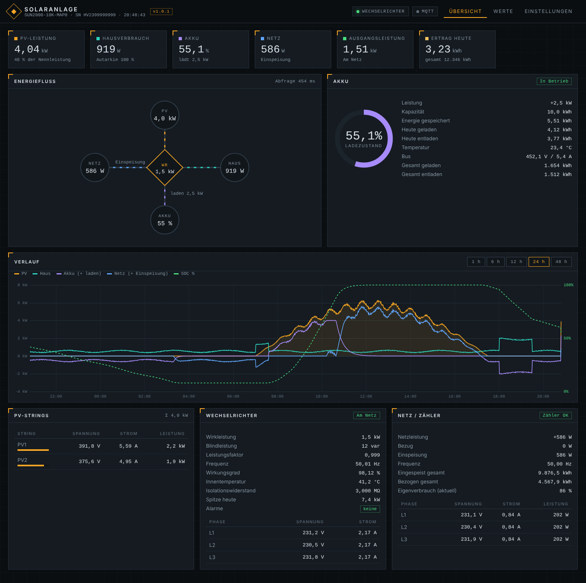
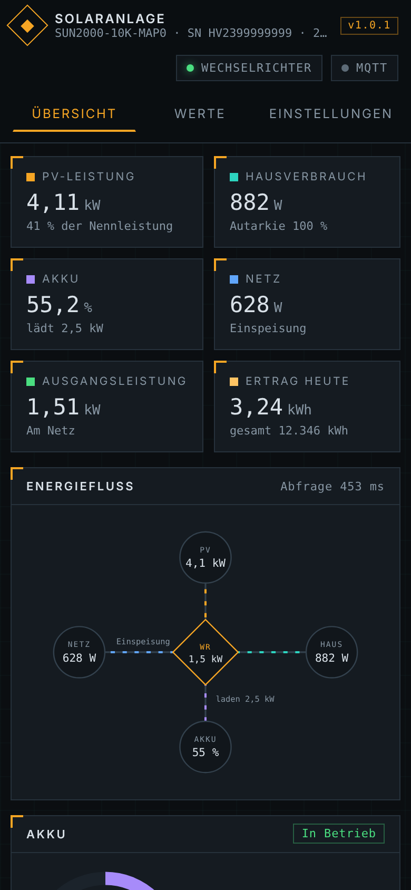

# Huawei-Solar-Dashboard-MK1

Zeigt die Live-Daten eines **Huawei SUN2000-5/6/8/10/12K-MAP0** Hybrid-Wechselrichters mit **LUNA2000-Akku** und **Smart Meter** auf einer Webseite im lokalen Netzwerk an und sendet jeden Wert als **eigenes MQTT-Topic** an einen Broker.



<p align="center"></p>

<sub>Screenshots mit Testdaten aus dem mitgelieferten Simulator.</sub>

- PV-Leistung gesamt und je String (Spannung, Strom, Leistung)
- Akku: Ladezustand (SOC), Lade-/Entladeleistung, Status, Temperatur, Tages- und Gesamtenergie
- Netz (Smart Meter): Bezug/Einspeisung, Phasenwerte, Zählerstände
- Wechselrichter: Ausgangsleistung, Status, Temperatur, Wirkungsgrad, Frequenz, Phasenspannungen und -ströme, Tages- und Gesamtertrag
- Berechnet: Hausverbrauch, Autarkiegrad, Eigenverbrauchsquote
- Energiefluss-Grafik, Verlauf bis 48 h (bleibt über Neustarts erhalten)
- Einstellungen komplett auf der Webseite, gespeichert in `config.json` neben der exe
- Nur Python-Standardbibliothek – keine Zusatzpakete, auch unter Linux / Raspberry Pi lauffähig
- **Nur lesend** – es wird nichts in den Wechselrichter geschrieben

## Start (Windows)

1. Zip aus dem Release entpacken.
2. `Huawei-Solar-Dashboard-MK1.exe` starten (Konsolenfenster zeigt das Protokoll).
3. Im Browser `http://<IP-des-Rechners>:8095/` öffnen → **Einstellungen**.
4. Wechselrichter-IP eintragen → **Verbindung testen** (probiert automatisch die Unit-IDs 1, 0 und 100) → **Speichern**.
5. Optional MQTT-Broker eintragen, „MQTT aktiv“ anhaken, speichern.

Beim ersten Start fragt Windows evtl. nach der Firewall-Freigabe – zulassen, damit die Seite im Netzwerk erreichbar ist.

## Modbus TCP am Wechselrichter freischalten

In der **FusionSolar-App** (lokal am Wechselrichter angemeldet, Installateur-Konto):
`Einstellungen → Kommunikationskonfiguration → Dongle-Parameter (bzw. Modbus TCP)` → **Aktivieren (uneingeschränkt)**.

| Anbindung | IP | Port | Unit-ID |
|---|---|---|---|
| SDongleA-05 im Heimnetz | IP des Dongles | 502 | meist 1 |
| integriertes WLAN-FE im Heimnetz (neuere Firmware) | IP des Wechselrichters | 502 | 0 oder 1 |
| Direkt am WLAN-Hotspot des Wechselrichters | 192.168.200.1 | 6607 | 0 |

Hinweise:
- Huawei bedient **nur einen Modbus-TCP-Client zuverlässig gleichzeitig**. Läuft schon eine andere Abfrage (z. B. Home Assistant, evcc), gibt es Abbrüche.
- Nach dem Verbindungsaufbau braucht das Gerät ca. 1–2 s Pause („Pause nach Verbinden“).
- Abfrageintervall nicht unter 5 s stellen – der SDongle ist langsam.

## MQTT

Alle Topics liegen unter dem Basis-Topic (Standard `huawei_solar`), z. B. `huawei_solar/akku/soc_pct`.
Werte werden als reine Zahl bzw. Text gesendet (Punkt als Dezimaltrenner).

- `…/status` – `online` / `offline` (Last Will, retained)
- `…/json` – alle Werte zusammen als JSON (abschaltbar)
- `…/akku/vorhanden`, `…/netz/zaehler_vorhanden` – `1` / `0`
- Akku-Topics werden nur gesendet, wenn ein Akku erkannt wurde; Netz-/Haus-Topics nur mit Smart Meter.
- Vorzeichen: `akku/leistung_w` **+ = laden**, `netz/leistung_w` **+ = Einspeisung**. Zusätzlich gibt es getrennte, immer positive Topics (`akku/ladeleistung_w`, `akku/entladeleistung_w`, `netz/bezug_w`, `netz/einspeisung_w`).
- Option „Nur Änderungen senden“: unveränderte Werte werden erst nach „Senden erzwingen nach (s)“ erneut gesendet.

| Gruppe | Topic (nach Basis-Topic) | Bedeutung | Einheit | Register |
|---|---|---|---|---|
| Gerät | `geraet/modell` | Modell | – | 30000 |
| Gerät | `geraet/seriennummer` | Seriennummer | – | 30015 |
| Gerät | `geraet/pv_strings` | Anzahl PV-Strings | – | 30071 |
| Gerät | `geraet/mpp_tracker` | Anzahl MPP-Tracker | – | 30072 |
| Gerät | `geraet/nennleistung_w` | Nennleistung | W | 30073 |
| PV | `pv/string1/spannung_v` | String 1 Spannung | V | 32016 |
| PV | `pv/string1/strom_a` | String 1 Strom | A | 32017 |
| PV | `pv/string2/spannung_v` | String 2 Spannung | V | 32018 |
| PV | `pv/string2/strom_a` | String 2 Strom | A | 32019 |
| PV | `pv/string3/spannung_v` | String 3 Spannung | V | 32020 |
| PV | `pv/string3/strom_a` | String 3 Strom | A | 32021 |
| PV | `pv/string4/spannung_v` | String 4 Spannung | V | 32022 |
| PV | `pv/string4/strom_a` | String 4 Strom | A | 32023 |
| PV | `pv/leistung_w` | PV-Eingangsleistung | W | 32064 |
| PV | `pv/string1/leistung_w` | String 1 Leistung | W | berechnet |
| PV | `pv/string2/leistung_w` | String 2 Leistung | W | berechnet |
| PV | `pv/string3/leistung_w` | String 3 Leistung | W | berechnet |
| PV | `pv/string4/leistung_w` | String 4 Leistung | W | berechnet |
| Wechselrichter | `wechselrichter/alarm1` | Alarm 1 (Bitfeld) | – | 32008 |
| Wechselrichter | `wechselrichter/alarm2` | Alarm 2 (Bitfeld) | – | 32009 |
| Wechselrichter | `wechselrichter/alarm3` | Alarm 3 (Bitfeld) | – | 32010 |
| Wechselrichter | `wechselrichter/spannung_l1_l2_v` | Spannung L1-L2 | V | 32066 |
| Wechselrichter | `wechselrichter/spannung_l2_l3_v` | Spannung L2-L3 | V | 32067 |
| Wechselrichter | `wechselrichter/spannung_l3_l1_v` | Spannung L3-L1 | V | 32068 |
| Wechselrichter | `wechselrichter/spannung_l1_v` | Spannung L1 | V | 32069 |
| Wechselrichter | `wechselrichter/spannung_l2_v` | Spannung L2 | V | 32070 |
| Wechselrichter | `wechselrichter/spannung_l3_v` | Spannung L3 | V | 32071 |
| Wechselrichter | `wechselrichter/strom_l1_a` | Strom L1 | A | 32072 |
| Wechselrichter | `wechselrichter/strom_l2_a` | Strom L2 | A | 32074 |
| Wechselrichter | `wechselrichter/strom_l3_a` | Strom L3 | A | 32076 |
| Wechselrichter | `wechselrichter/spitzenleistung_heute_w` | Spitzenleistung heute | W | 32078 |
| Wechselrichter | `wechselrichter/leistung_w` | Ausgangsleistung (Wirkleistung) | W | 32080 |
| Wechselrichter | `wechselrichter/blindleistung_var` | Blindleistung | var | 32082 |
| Wechselrichter | `wechselrichter/leistungsfaktor` | Leistungsfaktor | – | 32084 |
| Wechselrichter | `wechselrichter/frequenz_hz` | Netzfrequenz | Hz | 32085 |
| Wechselrichter | `wechselrichter/wirkungsgrad_pct` | Wirkungsgrad | % | 32086 |
| Wechselrichter | `wechselrichter/temperatur_c` | Innentemperatur | °C | 32087 |
| Wechselrichter | `wechselrichter/isolation_mohm` | Isolationswiderstand | MΩ | 32088 |
| Wechselrichter | `wechselrichter/status_code` | Gerätestatus (Code) | – | 32089 |
| Wechselrichter | `wechselrichter/ertrag_gesamt_kwh` | Gesamtertrag | kWh | 32106 |
| Wechselrichter | `wechselrichter/ertrag_heute_kwh` | Tagesertrag | kWh | 32114 |
| Wechselrichter | `wechselrichter/status` | Gerätestatus | – | berechnet |
| Akku | `akku/temperatur_c` | Akkutemperatur (Einheit 1) | °C | 37022 |
| Akku | `akku/max_ladeleistung_w` | Max. Ladeleistung | W | 37046 |
| Akku | `akku/max_entladeleistung_w` | Max. Entladeleistung | W | 37048 |
| Akku | `akku/kapazitaet_wh` | Nennkapazität | Wh | 37758 |
| Akku | `akku/soc_pct` | Ladezustand (SOC) | % | 37760 |
| Akku | `akku/status_code` | Betriebsstatus (Code) | – | 37762 |
| Akku | `akku/bus_spannung_v` | Bus-Spannung | V | 37763 |
| Akku | `akku/bus_strom_a` | Bus-Strom | A | 37764 |
| Akku | `akku/leistung_w` | Lade-/Entladeleistung (+ laden) | W | 37765 |
| Akku | `akku/geladen_gesamt_kwh` | Gesamt geladen | kWh | 37780 |
| Akku | `akku/entladen_gesamt_kwh` | Gesamt entladen | kWh | 37782 |
| Akku | `akku/geladen_heute_kwh` | Heute geladen | kWh | 37784 |
| Akku | `akku/entladen_heute_kwh` | Heute entladen | kWh | 37786 |
| Akku | `akku/status` | Betriebsstatus | – | berechnet |
| Akku | `akku/ladeleistung_w` | Ladeleistung | W | berechnet |
| Akku | `akku/entladeleistung_w` | Entladeleistung | W | berechnet |
| Netz | `netz/zaehler_status` | Zählerstatus (1 = normal) | – | 37100 |
| Netz | `netz/spannung_l1_v` | Spannung L1 | V | 37101 |
| Netz | `netz/spannung_l2_v` | Spannung L2 | V | 37103 |
| Netz | `netz/spannung_l3_v` | Spannung L3 | V | 37105 |
| Netz | `netz/strom_l1_a` | Strom L1 | A | 37107 |
| Netz | `netz/strom_l2_a` | Strom L2 | A | 37109 |
| Netz | `netz/strom_l3_a` | Strom L3 | A | 37111 |
| Netz | `netz/leistung_w` | Netzleistung (+ Einspeisung) | W | 37113 |
| Netz | `netz/blindleistung_var` | Blindleistung | var | 37115 |
| Netz | `netz/leistungsfaktor` | Leistungsfaktor | – | 37117 |
| Netz | `netz/frequenz_hz` | Frequenz | Hz | 37118 |
| Netz | `netz/eingespeist_gesamt_kwh` | Eingespeist gesamt | kWh | 37119 |
| Netz | `netz/bezogen_gesamt_kwh` | Bezogen gesamt | kWh | 37121 |
| Netz | `netz/leistung_l1_w` | Leistung L1 | W | 37132 |
| Netz | `netz/leistung_l2_w` | Leistung L2 | W | 37134 |
| Netz | `netz/leistung_l3_w` | Leistung L3 | W | 37136 |
| Netz | `netz/bezug_w` | Bezug aus dem Netz | W | berechnet |
| Netz | `netz/einspeisung_w` | Einspeisung ins Netz | W | berechnet |
| Haus | `haus/verbrauch_w` | Hausverbrauch | W | berechnet |
| Haus | `haus/eigenverbrauch_pct` | Eigenverbrauchsquote (aktuell) | % | berechnet |
| Haus | `haus/autarkie_pct` | Autarkiegrad (aktuell) | % | berechnet |

## Linux / Raspberry Pi

```sh
python3 app.py
```
Für den Autostart liegt unter `tools/linux/huawei-solar-dashboard.service` eine systemd-Vorlage.

## Testen ohne Wechselrichter

```sh
python tools/huawei_simulator.py --port 5502            # mit Akku und Zähler
python tools/huawei_simulator.py --port 5502 --ohne-akku --ohne-zaehler
```
Im Dashboard dann `127.0.0.1`, Port `5502`, Unit-ID `1` eintragen.

## Dateien

| Datei / Ordner | Inhalt |
|---|---|
| `app.py` | Programmstart, Webserver, Einstellungen, MQTT-Weiterleitung |
| `solar/registers.py` | Registertabelle und Topic-Namen |
| `solar/modbus.py` | Modbus-TCP-Client |
| `solar/inverter.py` | Abfrageschleife, abgeleitete Werte, Verlauf |
| `solar/mqtt.py` | MQTT-Client |
| `solar/webui.py` | Webseite |
| `tools/` | Simulator, Linux-Dienstvorlage |
| `docs/` | Screenshots für die README |
| `.github/workflows/build-exe.yml` | Build der Windows-exe und Release |
| `config.json` | wird beim ersten Start neben der exe angelegt |
| `daten/verlauf.json` | Verlauf der letzten 48 h |

## Build per GitHub Actions

Jeder Push baut die exe (Artefakt unter *Actions*). Steht in `app.py` eine neue `APP_VERSION`, wird automatisch ein Release `v<Version>` mit der Zip angelegt.

Wichtig: Der Ordner `.github` ist versteckt. Beim Hochladen über die GitHub-Weboberfläche wird er leicht vergessen – am besten per `git push` oder GitHub Desktop hochladen.
